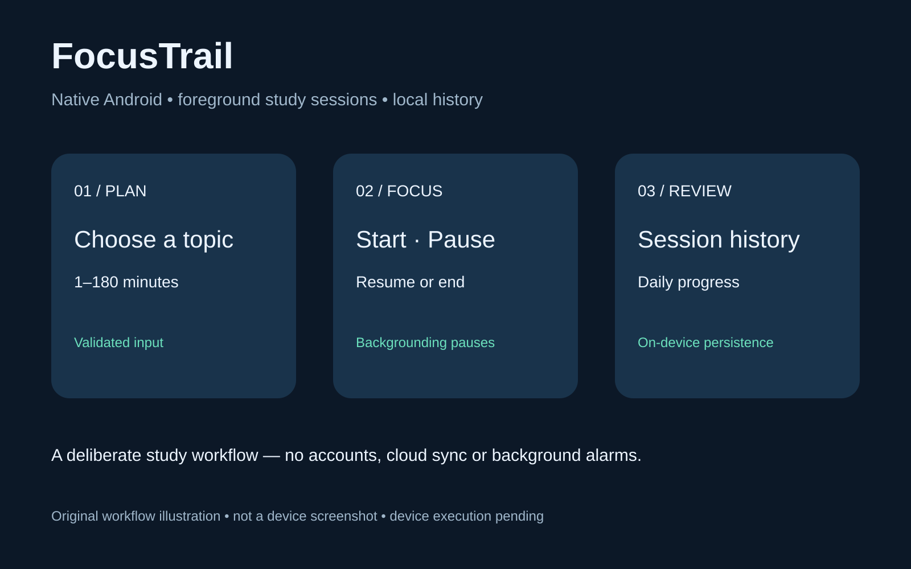

# FocusTrail — native Android study sessions

**Status: source prototype.** Twelve pure session-rule tests passed; Android APK build is blocked by compiler file-access errors. Device execution is unverified. Do not treat the workflow illustration as a running-app screenshot.

Java Android foreground study timer with pause/resume, locally saved session history and daily totals. A separate productivity workflow, not a reskinned inventory app. Build verification and device execution are reported separately.



## Features

- Study topic validation and configurable 1–180 minute sessions.
- Monotonic elapsed-time countdown, manual pause/resume, confirmation before ending.
- Completed versus early-ended history, up to200 most recent saved sessions.
- Daily elapsed-minute total and completed-session count.
- Local SharedPreferences JSON persistence, save-error feedback, history preservation on parse failure.
- Backgrounding pauses the timer intentionally; process recovery restores the last checkpoint paused. No background alarm, notification or wake-lock claims.

## Build

JDK17+, Gradle8.13, Android SDK35/platform/build tools, AGP8.13.2. No Gradle wrapper bundled. Install official Gradle or use Android Studio's configured Gradle; repositories are Google/MavenCentral. From project root:

```sh
gradle testDebugUnitTest assembleRelease
```

The source archive preserves `src/main/java`, `src/test/java`, manifest and build/settings files. Extract it into an empty folder before building. Unit tests do not require a device. Release signing is intentionally not configured; an unsigned APK cannot be installed directly. Configure your own signing locally; never commit keystores/passwords.

## Architecture and behavior

`SessionRules.java`: duration/topic validation, countdown arithmetic and display formatting. `MainActivity.java`: foreground lifecycle, session state, persistence, history and UI. `SessionRulesTest.java`: pure unit cases. Manifest has no internet permission and disables Android backup.

Leave the app and it pauses; tap Pause/Resume after returning. Active elapsed-time checkpoint survives normal background/process recreation, not every sudden crash. History date is the local date when the session is saved; sessions crossing midnight count on that saved date. Rotation/lifecycle timing, UI state, device clock changes, persistence failures and accessibility still require device verification. No export, account, reminders or multi-device sync yet. Ending a zero-elapsed session is allowed. The bounded history removes oldest entries when exceeding200; it is not an unlimited archive.

## Visual and provenance

`workflow.svg` is an original HD workflow illustration, **not a device screenshot** or proof of app execution. MIT. AI-assisted source, tests and documentation for Sadia Liaqat. No clients, deployment or production-readiness claims. Primary API references: [SystemClock](https://developer.android.com/reference/android/os/SystemClock), [SharedPreferences.Editor](https://developer.android.com/reference/android/content/SharedPreferences.Editor). See VERIFICATION.md.
